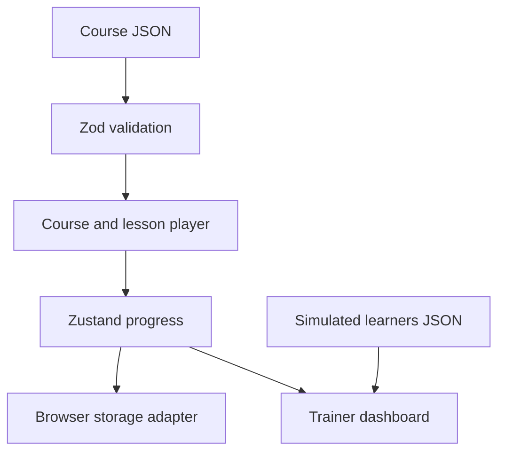

# CargoReady

CargoReady is a gamified portfolio demo for learning to recognise dangerous goods in air cargo. Play a cargo-desk scenario, sort sample items into hazard classes, and see how a learner’s decisions turn into progress and trainer analytics. The course has four sequential modules, 16 lessons, and six branching scenarios. CargoReady is an educational demo and provides no training certification.

**Live demo** · [CargoReady](https://cargoready.vercel.app/)

| Screenshot or GIF                             | Placeholder                     |
| --------------------------------------------- | ------------------------------- |
| Learner journey and unlocked modules          | Add a course screenshot here    |
| Cargo-desk choice, coach feedback, and ending | Add a short scenario GIF here   |
| Trainer charts and filtered table             | Add a dashboard screenshot here |

## Run locally

Use Node.js 22 or newer and npm.

```sh
npm install
npm run dev
```

Open the printed Vite URL. The learner journey is at `/course` and the trainer dashboard is at `/trainer`. Progress and preferences are stored in the current browser. To clear training results, use **Settings → Reset progress**.

### Five-minute walkthrough

1. Start training, choose an optional display name, and skip or browse the three-step tour.
2. Open Module 1 and mark the field guide as read. Play the event-supplies scenario and replay a different branch.
3. Sort the three sample items. Try a keyboard drop or use **Match without dragging**.
4. Take the four-question quiz. Refresh after an answer to see it restored. Passing requires 70%, so three correct answers pass this quiz.
5. Return to the journey to see Module 2 unlocked, then open **Trainer** and filter for **This device** to see where the quiz result went.

## Features and stack

| Technology                                | Role                                                                                                   |
| ----------------------------------------- | ------------------------------------------------------------------------------------------------------ |
| React 18, strict TypeScript, Vite         | Typed lesson views, fast development, and a static production build                                    |
| Tailwind CSS and CSS tokens               | Responsive layouts and shared light and dark themes                                                    |
| React Router 6                            | Deep links to lessons, course, settings, and trainer data                                              |
| Zustand and a storage adapter             | Saved progress, preferences, XP, streaks, quiz history, and a session fallback when storage is blocked |
| Zod                                       | Runtime validation of course content and saved training data                                           |
| Framer Motion and CSS                     | Landing illustration, journey progress, and lightweight level celebrations                             |
| dnd-kit                                   | Pointer and keyboard sorting with screen-reader announcements and an alternate matching form           |
| Recharts                                  | Lazy-loaded completion, scores, missed-question, and trend charts with readable value lists            |
| Vitest, React Testing Library, Playwright | Logic tests, component tests in Chromium, and a full Module 1 smoke flow                               |
| ESLint and Prettier                       | Static checks and consistent formatting                                                                |

Learners earn quiz combo XP, day streaks, levels, and eight rule-based badges. The trainer dashboard labels simulated data separately from this browser’s progress, supports learner search and sorting, and exports filtered rows as CSV.

## Architecture



`src/content/air-cargo-basics.json` lists modules, prerequisites, and lessons. Each lesson has a stable ID and a `type` of `info`, `scenario`, `dragdrop`, or `quiz`. Scenario choices reference the next node by ID, and terminal nodes carry the outcome and review text. Sorting lessons map item IDs to target IDs. Quiz answers refer to the original option index, which keeps grading correct when options shuffle.

`src/store` owns persistence. Pure scoring, streak, scenario, and unlock rules can run independently of the UI. Trainer analytics combine simulated records with up to the latest 50 completed quiz attempts per quiz from this device. Older saved scores without timestamps can contribute to summary scores and stay out of the daily trend.

## Checks and accessibility

```sh
npm run typecheck
npm run lint
npm run format:check
npm test
npm run build
npx playwright install chromium
npm run test:e2e
```

Playwright starts Vite and checks 360px, 768px, and 1280px Chromium layouts. The browser suite covers a full Module 1 completion, persistence across a reload, keyboard sorting, mouse or touch sorting, and isolated quiz and scenario components.

- Use the skip link, visible focus rings, and semantic controls to navigate by keyboard. Sorting uses **Space** or **Enter**, arrow keys, and **Escape** to cancel. The alternate matching form offers the same activity with standard form controls.
- The app supports three text sizes and light and dark themes. The reduce-motion preference and device setting suppress celebratory animation. Quiz countdowns and training sounds are opt-in.
- The source audit checked selected text, focus, and UI color pairs against WCAG contrast thresholds. Browser checks, assistive-technology checks, and Lighthouse scoring require a running build. Performance targets are 90+ Performance, 95+ Accessibility, and 95+ Best Practices.

## Vercel

Use `vercel deploy` for a preview and `vercel deploy --prod` for production. `vercel.json` defines `npm run build`, the `dist` output directory, and the rewrite for React Router deep links. The app runs without environment variables. Verify direct visits to `/course` and `/trainer` after deployment.

## How I would extend this

- Add SCORM or xAPI export for completions, scores, and attempt events.
- Replace browser-local storage with a backend and authenticated learner and trainer accounts.
- Localise content and UI strings in English and Hindi.
- Integrate with an LMS for enrolment and grade reporting.
- Add a Unity WebGL mini-game for a timed cargo-identification exercise with keyboard alternatives.
